# Plataforma Web Oficial — IV Congreso Internacional de Ciencia e Ingeniería (CICI 2027)
**Facultad de Ingeniería · Universidad Mariana (San Juan de Pasto, Nariño, Colombia)**  
Sitio oficial de referencia: [https://cici.umariana.edu.co/](https://cici.umariana.edu.co/)

---

## 1. Credenciales de Acceso Iniciales (creadas automáticamente por los Seeders)

Al ejecutar `php artisan migrate --seed` (o al desplegar en Render / Docker, donde las migraciones y *seeders* se ejecutan automáticamente), el sistema habilita las cuentas oficiales:

| Rol en la Plataforma | Correo electrónico | Contraseña | Ruta de acceso |
|---|---|---|---|
| **Administrador General** | `admin@cici.test` | `Cici2027*` | `/login` → `/admin` |
| **Líder del Comité Científico** (Ing. Civil) | `comite@cici.test` | `Comite2027*` | `/login` → `/comite/resumenes` |
| **Evaluadora del Comité Científico** (Ing. Ambiental) | `evaluador@cici.test` | `Comite2027*` | `/login` → `/comite/resumenes` |

### Cédulas de prueba para Consulta Pública (`/estado-resumen`)
- `1085200101` — **Aprobado en Modalidad Póster** (habilita descarga de plantilla de póster).
- `1085200202` — **Aprobado en Ponencia Oral**.
- `1085200303` — **En revisión por el Comité Científico**.

---

## 2. Diagrama Entidad-Relación (ERD) de la Base de Datos

El modelo de datos relacional normalizado consta de **16 tablas de dominio** que soportan todos los módulos dinámicos del congreso, el arbitraje del Comité Científico y la consulta pública por cédula:

```mermaid
erDiagram
    USERS ||--o{ SUBMISSIONS : "assigned_to / reviewed_by"
    USERS ||--o{ CONTACT_MESSAGES : "responded_by"
    THEMATIC_AXES ||--o{ USERS : "thematic_axis_id (comité)"
    THEMATIC_AXES ||--o{ AXIS_TOPICS : "tiene líneas temáticas"
    THEMATIC_AXES ||--o{ SUBMISSIONS : "clasifica resumen"
    THEMATIC_AXES ||--o{ SCHEDULE_ITEMS : "asocia sesión"
    AXIS_TOPICS ||--o{ SUBMISSIONS : "subtema específico"

    USERS {
        bigint id PK
        string name
        string email UK
        string password
        boolean is_admin
        boolean is_committee
        boolean is_committee_leader
        string specialty
        bigint thematic_axis_id FK
    }

    THEMATIC_AXES {
        bigint id PK
        string name
        boolean is_transversal
        int sort_order
    }

    AXIS_TOPICS {
        bigint id PK
        bigint thematic_axis_id FK
        string name
        int sort_order
    }

    SPEAKERS {
        bigint id PK
        string name
        string photo
        string job_title
        string specialty
        string institution
        string city
        string country
        text bio
        string talk_title
        int sort_order
    }

    IMPORTANT_DATES {
        bigint id PK
        string title
        date date
        date end_date
        boolean is_featured
    }

    SUBMISSIONS {
        bigint id PK
        string tracking_code UK
        string document_type
        string document "Indexado para consulta por cédula"
        string name
        string email
        string phone
        string institution
        string title
        bigint thematic_axis_id FK
        bigint axis_topic_id FK
        string requested_modality "oral | poster"
        string status "pending | under_review | approved | rejected"
        string modality "oral | poster (aprobada)"
        tinyint score
        text review_comment
        bigint assigned_to FK
        bigint reviewed_by FK
        timestamp reviewed_at
        timestamp notified_at
    }

    CONGRESS_SETTINGS {
        bigint id PK
        string key UK "event_year, event_logo_white, etc."
        text value
        string label
        string group
    }

    REGISTRATION_FEES {
        bigint id PK
        string profile
        text description
        string price_formatted
        bigint price_amount
        string currency
        string includes
        int sort_order
        boolean is_active
    }

    CONGRESS_DOCUMENTS {
        bigint id PK
        string slug UK
        string title
        string category
        string external_url
        string file_path
        string version
        string status "disponible | proximamente | oculto"
        int sort_order
    }

    SCHEDULE_ITEMS {
        bigint id PK
        string day_label
        date event_date
        string start_time
        string end_time
        string title
        text description
        string speaker_name
        string location
        string activity_type
        bigint thematic_axis_id FK
        int sort_order
        boolean is_published
    }

    NEWS_POSTS {
        bigint id PK
        string title
        string slug UK
        string category
        text summary
        longtext content
        string image_path
        string external_url
        boolean is_featured
        boolean is_published
        timestamp published_at
    }

    ORGANIZER_MEMBERS {
        bigint id PK
        string name
        string role
        string committee_type
        string institution
        string program_or_unit
        int sort_order
        boolean is_active
    }

    GALLERY_ITEMS {
        bigint id PK
        string edition
        smallint year
        string title
        text description
        string participants_count
        string papers_count
        int sort_order
        boolean is_published
    }

    SPONSORS {
        bigint id PK
        string name
        string category
        string country
        string website_url
        string description
        int sort_order
        boolean is_active
    }

    FAQS {
        bigint id PK
        string question
        text answer
        string category
        int sort_order
        boolean is_published
    }

    CONTACT_MESSAGES {
        bigint id PK
        string name
        string email
        string phone
        string institution
        string category
        string subject
        text message
        string status "nuevo | en_proceso | respondido"
        text admin_notes
        bigint responded_by FK
    }
```



---

## 3. Mapa de Navegación del Sitio (Sitemap)

```mermaid
flowchart TD
    A["Portal Público CICI (/)"] --> A1["#inicio · Hero Dinámico y Cuenta Regresiva"]
    A --> A2["#congreso · Presentación y 3 Pilares"]
    A --> A3["#fechas · Cronograma Oficial"]
    A --> A4["#ejes · 6 Ejes y 34 Líneas Temáticas"]
    A --> A5["#ponentes · 7 Ponentes Invitados y Perfiles"]
    A --> A6["#programa · Agenda de 3 Jornadas (14, 15 y 16 de abril)"]
    A --> A7["#inscripciones · Tarifas, Términos PDF y Enlace SGA Campus"]
    A --> A8["#documentos · Términos PDF, Formato Resumen, Material Difusión"]
    A --> A9["#noticias · Comunicados, #comite, #trayectoria, #aliados, #preguntas-frecuentes"]
    A --> A10["#contacto · Canales Oficiales y Formulario de Mesa de Ayuda"]

    A --> B["Consulta Pública por Cédula (/estado-resumen)"]
    A --> C["Formulario de Resúmenes (/enviar-resumen o Google Forms)"]
    A --> D["Autenticación (/login)"]

    D -->|Rol Comité Científico| E["Panel Comité Científico (/comite/resumenes)"]
    E --> E1["Filtrar por estado, eje, modalidad o cédula"]
    E --> E2["Dictaminar resumen: Aprobar (Oral o Póster) / Rechazar + Puntaje"]
    E --> E3["Líder de Comité: Asignar evaluador y crear miembros del comité"]

    D -->|Rol Administrador| F["Panel de Administración General (/admin)"]
    F --> F1["/admin/configuracion · Año (2027↔2028), Logos, Enlaces y Tarifas"]
    F --> F2["/admin/ponentes · CRUD de Ponentes y Fotos"]
    F --> F3["/admin/ejes · CRUD de Ejes y Subtemas"]
    F --> F4["/admin/fechas · CRUD de Fechas Importantes"]
    F --> F5["/admin/programa · CRUD de Agenda por Jornada y Auditorio"]
    F --> F6["/admin/documentos · Subida de PDFs, Plantillas y Estados"]
    F --> F7["/admin/noticias · CRUD de Noticias y Comunicados"]
    F --> F8["/admin/contenido-portal · Comité Público, Galería, Aliados y FAQ"]
    F --> F9["/admin/mensajes · Bandeja de Entrada de Consultas Ciudadanas"]
```



---

## 4. Matriz de Trazabilidad de Requerimientos (RF-01 a RF-16)

| Código | Requerimiento Funcional | Componentes Implementados | Estado |
|---|---|---|---|
| **RF-01** | Información general e identidad (editable para 2027/2028 y logos) | `CongressSetting`, `CongressSettingController`, `/admin/configuracion` | ✅ 100% |
| **RF-02** | Ejes temáticos (6 ejes y 34 subtemas oficiales) | `ThematicAxis`, `AxisTopic`, `ThematicAxisController`, `/admin/ejes` | ✅ 100% |
| **RF-03** | Fechas importantes y cuenta regresiva dinámica | `ImportantDate`, `ImportantDateController`, `/admin/fechas`, `cici.js` | ✅ 100% |
| **RF-04** | Programa y agenda académica (3 jornadas, 15 bloques oficiales) | `ScheduleItem`, `ScheduleItemController`, `/admin/programa` | ✅ 100% |
| **RF-05** | Ponentes invitados y conferencistas (con fotos y perfiles) | `Speaker`, `SpeakerController`, `/admin/ponentes` | ✅ 100% |
| **RF-06** | Modalidades de participación y tarifas oficiales (COP) | `RegistrationFee`, `CongressSettingController`, `/admin/configuracion` | ✅ 100% |
| **RF-07** | Descarga de documentos y plantillas oficiales (PDF Términos, etc.) | `CongressDocument`, `CongressDocumentController`, `/admin/documentos` | ✅ 100% |
| **RF-08** | Noticias, novedades y avisos oficiales | `NewsPost`, `NewsPostController`, `/admin/noticias` | ✅ 100% |
| **RF-09** | Comité Directivo, Científico y Organizador público | `OrganizerMember`, `PortalContentController`, `/admin/contenido-portal` | ✅ 100% |
| **RF-10** | Galería e histórico de ediciones anteriores (I, II y III CICI) | `GalleryItem`, `PortalContentController`, `/admin/contenido-portal` | ✅ 100% |
| **RF-11** | Aliados, patrocinadores y universidades participantes | `Sponsor`, `PortalContentController`, `/admin/contenido-portal` | ✅ 100% |
| **RF-12** | Preguntas frecuentes (FAQ) | `Faq`, `PortalContentController`, `/admin/contenido-portal` | ✅ 100% |
| **RF-13** | Canales de contacto y formulario de mesa de ayuda | `ContactMessage`, `ContactController`, `ContactMessageController`, `/admin/mensajes` | ✅ 100% |
| **RF-14** | Enlace a plataforma externa de inscripción financiera (SGA Campus) | `CongressSetting` (`registration_url`), `#inscripciones` | ✅ 100% |
| **RF-15** | Panel de administración general y gestión de contenidos | `DashboardController`, `IsAdmin`, `/admin/*` | ✅ 100% |
| **RF-16** | Flujo Comité Científico y Consulta Pública de estado por Cédula | `Submission`, `CommitteeSubmissionController`, `SubmissionStatusController`, `/estado-resumen` | ✅ 100% |

### Arquitectura de Alto Rendimiento y Seguridad (Soporte para 2.000 usuarios concurrentes)
- **Caché inteligente de portal (`App\Support\PortalCache`)**: La portada consolida todas las consultas de lectura bajo caché con invalidación automática mediante *Model Events* en `AppServiceProvider` cada vez que el administrador edita cualquier registro.
- **Índices compuestos (`2026_10_20_110000_add_performance_indexes_for_high_concurrency.php`)**: Índices en `submissions(document, status)`, `submissions(thematic_axis_id, status)`, `schedule_items`, `news_posts` y `contact_messages`.
- **Cabeceras de seguridad HTTP (`App\Http\Middleware\SecurityHeaders`)**: Protección activa con `X-Frame-Options: SAMEORIGIN`, `X-Content-Type-Options: nosniff`, `Referrer-Policy: strict-origin-when-cross-origin` y `Permissions-Policy`.

---

## 5. Ejecución Local (Visual Studio Code / Windows)

```powershell
# 1. Instalar dependencias (si copiaste la carpeta sin vendor o node_modules)
composer install
npm install

# 2. Preparar base de datos SQLite local, enlaces simbólicos y datos oficiales
php artisan storage:link
php artisan migrate:fresh --seed

# 3. Levantar el servidor (en dos terminales de VS Code):
# Terminal 1:
npm run dev
# Terminal 2:
php artisan serve
```
Luego abre **[http://127.0.0.1:8000](http://127.0.0.1:8000)**.

---

## 6. Despliegue en Render y en el Servidor de la Universidad Mariana

### En Render (`Dockerfile` + `docker/entrypoint.sh` + `render.yaml`)
- El contenedor detecta automáticamente si existe `DB_URL` (`postgresql://...`) o si debe usar `sqlite`.
- Ejecuta automáticamente `php artisan migrate --force` y `php artisan db:seed --force` al arrancar, además de contar con autoseeding preventivo en `LoginRequest` y `HomeController`.

### En el Servidor Institucional (`cici.umariana.edu.co`)
```bash
composer install --no-dev --optimize-autoloader
npm ci && npm run build
php artisan key:generate --force
php artisan storage:link
php artisan migrate --seed --force
php artisan optimize
```
